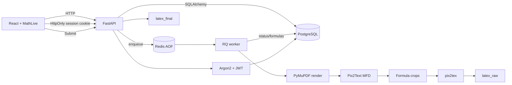

# Kiến trúc

## Kiểu hệ thống

React/Vite frontend + FastAPI backend + PostgreSQL + Redis/RQ + worker riêng. Backend dùng lớp `api`, `core`, `models`, `schemas`, `services`; worker dùng chung package backend nhưng là process khác. Đây là modular monolith nhỏ có background worker, không phải microservices.

## Ranh giới

- `api`: HTTP validation, transaction, enqueue; không chạy model nặng.
- `core`: database, Redis/RQ connection.
- `models`: SQLAlchemy mapping.
- `schemas`: request/response contract.
- `services`: render, detection, crop, OCR.
- `frontend`: upload, polling, review bbox, LaTeX/MathLive, Submit.
- `worker`: thực thi importable jobs từ Redis.
- `auth`: register/login/me/logout; Argon2 password hash, JWT HttpOnly cookie; document ownership check ở API.

## Trạng thái

Document: `processing_pages` → `detecting_formulas` → `formula_proposals_ready` → `ocr_processing` → `ocr_complete`/`ocr_completed_with_errors`; render failure có `processing_failed`.

Formula: `proposed` → `ocr_queued` → `ocr_complete`/`ocr_failed` → `submitted`.

PostgreSQL là nguồn canonical. Redis/AOF điều phối job, không thay database. File lớn lưu theo document UUID trong uploads volume.

## API contract (khớp `/openapi.json` ngày 2026-11-10)

Tất cả endpoint `/api/documents/**` yêu cầu cookie đăng nhập và chỉ cho owner; document của người khác trả 404. Cookie phiên, bbox pixel, page từ 1 theo [MODULE_OWNERSHIP](MODULE_OWNERSHIP.md).

| Method | Path | Thành công | Ghi chú |
|---|---|---|---|
| POST | `/api/auth/register` | 201 | Username chuẩn hóa lowercase; trùng → 409 |
| POST | `/api/auth/login` | 200 | Đặt cookie HttpOnly; sai → 401 |
| GET | `/api/auth/me` | 200 | Chưa đăng nhập → 401 |
| POST | `/api/auth/logout` | 204 | Xóa cookie |
| POST | `/api/documents/upload` | 200 | Chỉ PDF, tối đa 100 MB; enqueue xử lý nền |
| GET | `/api/documents` | 200 | Lịch sử, phân trang, lọc status |
| GET / DELETE | `/api/documents/{id}` | 200 / 204 | Xóa bị chặn khi đang xử lý |
| GET | `/api/documents/{id}/source` | 200 | Tải PDF gốc |
| GET | `/api/documents/{id}/export` | 200 | `.tex` từ `latex_final`; chưa Submit → 409 |
| GET | `/api/documents/{id}/pages`, `/pages/{page_number}` | 200 | Ảnh/trang đã render |
| GET | `/api/documents/{id}/formulas` | 200 | Danh sách vùng + raw/final/status |
| POST | `/api/documents/{id}/formulas` | 201 | Thêm vùng thủ công |
| PATCH / DELETE | `/api/documents/{id}/formulas/{fid}` | 200 / 204 | Sửa/xóa vùng |
| GET | `/api/documents/{id}/formulas/{fid}/image` | 200 | Ảnh crop |
| POST | `/api/documents/{id}/formulas/recognize` | 202 | Enqueue OCR các vùng `proposed` |
| POST | `/api/documents/{id}/formulas/retry` | 202 | Enqueue lại các vùng `ocr_failed` |
| POST | `/api/documents/{id}/formulas/{fid}/submit` | 200 | Ghi `latex_final`, không đổi `latex_raw` |
| GET | `/health` | 200 | Không cần đăng nhập |

Khác kế hoạch đã duyệt: không có `POST /documents/{id}/process` đồng bộ (quyết định D-09 trong [PHAN_CONG_CONG_VIEC](PHAN_CONG_CONG_VIEC.md)).

## GPU và độ tin cậy

GPU là tùy chọn: dòng `gpus: all` của worker trong Compose đang comment và `MATH_DETECTOR_DEVICE` mặc định `cpu`. Kiểm tra ngày 2026-11-10 trong worker: PyTorch `2.15.0+cu132` báo `cuda_available=False`, ONNX providers là `AzureExecutionProvider, CPUExecutionProvider`, container không có `nvidia-smi` — tức đang chạy CPU. Khi bật GPU, host và worker container cần `nvidia-smi`, PyTorch CUDA và ONNX provider/inference đều được xác minh riêng. Pix2Text ONNX CUDA từng báo warning plugin EP; nếu còn lỗi, thử MFD PyTorch backend CUDA. Redis AOF + volume giúp giữ queue, nhưng cần test worker restart, retry/idempotency và failed job policy.

Production nhiều host cần shared object storage/volume cho file và model cache; local Compose dùng bind mount.

### Cấu hình suy luận đã chốt (S2-05): CPU

Chưa có GPU trong Docker trên máy phát triển (không `nvidia-smi`, `cuda_available=False`, ONNX chỉ có CPU provider) nên cấu hình CUDA **chưa được đo và chưa được chọn**. Cấu hình chạy được và đã đo là CPU (`MATH_DETECTOR_DEVICE=cpu`, `MATH_DETECTOR_BACKEND=onnx`), trong worker 16 vCPU / 8 GB RAM, ngày 2026-11-10, trang 1024×736 của đề thi 15 trang:

| Hạng mục | Kết quả |
|---|---|
| Nạp model detector / OCR (cold) | 4,4 s / 1,9 s |
| Detect mỗi trang: trang đầu / trung bình các trang sau | 0,98 s / 0,64 s |
| OCR mỗi crop (40 crop): đầu / trung bình sau / lớn nhất | 0,52 s / 0,23 s / 0,83 s |
| RSS đỉnh của process worker | ≈ 1,2 GB sau khi nạp, ≈ 1,8 GB sau khi chạy |
| Thực tế end-to-end, PDF 17 trang, 130 vùng | detect ≈ 35 s, OCR ≈ 46 s |

Số liệu là một lần đo trên một máy, không phải benchmark; dùng để đặt kỳ vọng và thiết lập timeout (job timeout hiện 7200 s). Khi có máy GPU, bật `gpus: all` và `MATH_DETECTOR_DEVICE=cuda`, kiểm tra provider rồi đo lại bằng cùng cách; chỉ chuyển cấu hình khi số đo tốt hơn và inference thật chạy trong worker.

### Phục hồi job (S2-03, S2-04)

- Mọi job đưa vào RQ kèm `on_failure` (`mark_pdf_job_failed`, `mark_ocr_job_failed`). RQ gọi callback khi job ném lỗi, quá timeout hoặc bị bỏ rơi vì worker chết.
- OCR: công thức còn `ocr_queued` → `ocr_failed`, document `ocr_processing` → `ocr_completed_with_errors`; người dùng bấm **Thử OCR lại** (`/formulas/retry`). Công thức đã `ocr_complete`/`submitted` không bị đụng.
- Render/detect: document `processing_pages`/`detecting_formulas` → `processing_failed`.
- Job chạy trùng là no-op: OCR bỏ qua công thức không còn `ocr_queued` (kiểm tra lại từng công thức trước khi chạy); job PDF chỉ chạy khi document còn `processing_pages`.
- Drill đã chạy ngày 2026-11-10 (dữ liệu tạm, đã xóa):
  1. Kill worker khi OCR đang chạy (41 công thức xong, 89 còn `ocr_queued`). Sau ≥ 100 s (hết heartbeat) khởi động lại worker: trong 6 s RQ đưa job vào failed registry, callback chạy, 89 công thức → `ocr_failed`, document `ocr_completed_with_errors`. Gọi `/retry` → 89 công thức OCR xong, document `ocr_complete`.
  2. Dừng worker, upload (job nằm trong Redis), restart Redis (AOF bật): `rq info` vẫn thấy job; khởi động worker → document tới `formula_proposals_ready`.
  3. Dừng Redis rồi upload: API trả 503, document `processing_failed`.
- Giới hạn đã biết: nếu worker chết nhưng không khởi động lại, công thức vẫn `ocr_queued` cho tới khi có worker chạy cleanup; mất dữ liệu Redis (xóa volume/`FLUSHALL`) làm mất job đang chờ mà không có callback — document kẹt `ocr_processing`/`processing_pages` (chưa có cơ chế phát hiện). `restart: unless-stopped` của worker chưa được kiểm chứng bằng crash thật (`docker kill` được tính là dừng thủ công nên không restart).

## Authentication/security boundary

- Access token JWT ngắn hạn (60 phút) nằm trong cookie HttpOnly `math2latex_access`, `SameSite=Lax`, `Path=/api`; không expose cho JavaScript.
- `AUTH_SECRET` phải là secret random riêng khi deploy (≥ 32 ký tự); giá trị mặc định trong Compose chỉ dùng local. Đổi `AUTH_SECRET` làm mọi phiên đang đăng nhập hết hiệu lực (người dùng đăng nhập lại); không hỗ trợ hai secret song song. Secret ngắn hơn 32 ký tự thì không cấp và không chấp nhận token.
- Cookie `Secure` bật qua `AUTH_COOKIE_SECURE=true` khi chạy HTTPS.
- Đăng nhập sai: tối đa 5 lần cho mỗi (IP, username) và 30 lần cho mỗi IP trong 15 phút (`LOGIN_MAX_FAILURES`, `LOGIN_IP_MAX_FAILURES`, `LOGIN_WINDOW_SECONDS`); vượt thì 429 kèm `Retry-After`; đăng nhập đúng xóa bộ đếm của cặp (IP, username). Bộ đếm nằm trong Redis; Redis lỗi thì cho qua và ghi log (không khóa người dùng vì Redis chết). IP lấy từ kết nối TCP: sau reverse proxy cần cấu hình proxy headers, nếu không mọi người dùng chung một IP.
- CSRF: `SameSite=Lax` chặn cookie trong request ghi cross-site; thêm một lớp là middleware từ chối (403) request `POST/PUT/PATCH/DELETE` có header `Origin` không thuộc allowlist. Request không có `Origin` (curl, script) vẫn đi qua vì không phải CSRF từ trình duyệt. Chưa có token CSRF riêng.
- CORS và kiểm tra Origin dùng chung allowlist `CORS_ORIGINS` (phân tách bằng dấu phẩy; mặc định `http://localhost:5173,http://127.0.0.1:5173`); production phải đặt origin thật.
- Không ghi mật khẩu hoặc token vào log (có test); hash Argon2 không xuất hiện trong response.
- Hiện chỉ có username/password và owner scoping; chưa có role, reset password, email verification hoặc refresh-token rotation.

## Giới hạn upload và xử lý

Giá trị mặc định, đổi bằng biến môi trường (xem `backend/app/core/limits.py`); `docker-compose.yml` truyền các biến này từ môi trường/`.env` của host cho backend (và `MAX_PDF_PAGES`, `MAX_PAGE_PIXELS` cho worker), sau đó cần `docker compose up -d` để tạo lại container:

| Giới hạn | Mặc định | Biến |
|---|---|---|
| Dung lượng file | 100 MB (413) | `MAX_UPLOAD_MB` |
| Số trang PDF | 200 (422) | `MAX_PDF_PAGES` |
| Pixel mỗi trang khi render 150 dpi | 25 triệu, A4 ≈ 2,2 triệu (422) | `MAX_PAGE_PIXELS` |
| Timeout job render/detect | 1800 s | `PDF_JOB_TIMEOUT_SECONDS` |
| Timeout job OCR | 3600 s | `OCR_JOB_TIMEOUT_SECONDS` |

Các giá trị trên do nhóm chọn, có dư nhiều lần so với số đo CPU ở mục Cấu hình suy luận, chưa phải yêu cầu từ giảng viên. Nội dung được kiểm tra bằng cách mở file: phải là PDF thật (ảnh đổi đuôi `.pdf`, file hỏng, file rỗng → 400), không cần mật khẩu (400), tên file chỉ giữ phần tên (bỏ thư mục, ký tự điều khiển, tối đa 255 ký tự); file luôn lưu ở `UPLOAD_DIR/<uuid>/source.pdf` nên tên do client gửi không quyết định đường dẫn. Upload bị từ chối không để lại thư mục hay dòng database. Worker kiểm tra lại cùng giới hạn trước khi render.