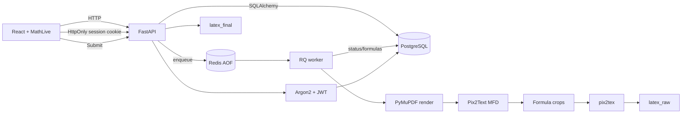

# Kiến trúc

## Kiểu hệ thống

React/Vite frontend + FastAPI backend + PostgreSQL + Redis/RQ + worker riêng. Backend dùng lớp `api`, `core`, `models`, `schemas`, `services`; worker dùng chung package backend nhưng là process khác. Đây là modular monolith nhỏ có background worker, không phải microservices.

## Ranh giới

- `api`: HTTP validation, transaction, enqueue; không chạy model nặng.
- `core`: database, Redis/RQ connection.
- `models`: SQLAlchemy mapping.
- `schemas`: request/response contract.
- `services`: render, detection, crop, OCR.
- `frontend`: upload, polling, review bbox, LaTeX/MathLive, Submit.
- `worker`: thực thi importable jobs từ Redis.
- `auth`: register/login/me/logout; Argon2 password hash, JWT HttpOnly cookie; document ownership check ở API.

## Trạng thái

Document: `processing_pages` → `detecting_formulas` → `formula_proposals_ready` → `ocr_processing` → `ocr_complete`/`ocr_completed_with_errors`; render failure có `processing_failed`.

Formula: `proposed` → `ocr_queued` → `ocr_complete`/`ocr_failed` → `submitted`.

PostgreSQL là nguồn canonical. Redis/AOF điều phối job, không thay database. File lớn lưu theo document UUID trong uploads volume.

## GPU và độ tin cậy

Compose yêu cầu GPU ở worker. Host và worker container cần `nvidia-smi`, PyTorch CUDA và ONNX provider/inference đều được xác minh riêng. Pix2Text ONNX CUDA từng báo warning plugin EP; nếu còn lỗi, thử MFD PyTorch backend CUDA. Redis AOF + volume giúp giữ queue, nhưng cần test worker restart, retry/idempotency và failed job policy.

Production nhiều host cần shared object storage/volume cho file và model cache; local Compose dùng bind mount.

## Authentication/security boundary

- Access token JWT ngắn hạn nằm trong cookie HttpOnly `math2latex_access`, không expose cho JavaScript.
- `AUTH_SECRET` phải là secret random riêng khi deploy; giá trị mặc định trong Compose chỉ dùng local.
- Cookie `Secure` bật qua `AUTH_COOKIE_SECURE=true` khi chạy HTTPS.
- CORS dùng allowlist local origins và credentials; production phải thay origin.
- Hiện chỉ có username/password và owner scoping; chưa có role, reset password, email verification, refresh-token rotation hoặc CSRF token riêng.