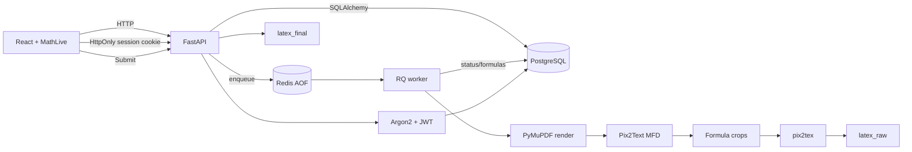

# Kiến trúc

## Kiểu hệ thống

React/Vite frontend + FastAPI backend + PostgreSQL + Redis/RQ + worker riêng. Backend dùng lớp `api`, `core`, `models`, `schemas`, `services`; worker dùng chung package backend nhưng là process khác. Đây là modular monolith nhỏ có background worker, không phải microservices.

## Ranh giới

- `api`: HTTP validation, transaction, enqueue; không chạy model nặng.
- `core`: database, Redis/RQ connection.
- `models`: SQLAlchemy mapping.
- `schemas`: request/response contract.
- `services`: render, detection, crop, OCR.
- `frontend`: upload, polling, review bbox, LaTeX/MathLive, Submit.
- `worker`: thực thi importable jobs từ Redis.
- `auth`: register/login/me/logout; Argon2 password hash, JWT HttpOnly cookie; document ownership check ở API.

## Trạng thái

Document: `processing_pages` → `detecting_formulas` → `formula_proposals_ready` → `ocr_processing` → `ocr_complete`/`ocr_completed_with_errors`; render failure có `processing_failed`.

Formula: `proposed` → `ocr_queued` → `ocr_complete`/`ocr_failed` → `submitted`.

PostgreSQL là nguồn canonical. Redis/AOF điều phối job, không thay database. File lớn lưu theo document UUID trong uploads volume.

## API contract (khớp `/openapi.json` ngày 2026-11-10)

Tất cả endpoint `/api/documents/**` yêu cầu cookie đăng nhập và chỉ cho owner; document của người khác trả 404. Cookie phiên, bbox pixel, page từ 1 theo [MODULE_OWNERSHIP](MODULE_OWNERSHIP.md).

| Method | Path | Thành công | Ghi chú |
|---|---|---|---|
| POST | `/api/auth/register` | 201 | Username chuẩn hóa lowercase; trùng → 409 |
| POST | `/api/auth/login` | 200 | Đặt cookie HttpOnly; sai → 401 |
| GET | `/api/auth/me` | 200 | Chưa đăng nhập → 401 |
| POST | `/api/auth/logout` | 204 | Xóa cookie |
| POST | `/api/documents/upload` | 200 | Chỉ PDF, tối đa 100 MB; enqueue xử lý nền |
| GET | `/api/documents` | 200 | Lịch sử, phân trang, lọc status |
| GET / DELETE | `/api/documents/{id}` | 200 / 204 | Xóa bị chặn khi đang xử lý |
| GET | `/api/documents/{id}/source` | 200 | Tải PDF gốc |
| GET | `/api/documents/{id}/export` | 200 | `.tex` từ `latex_final`; chưa Submit → 409 |
| GET | `/api/documents/{id}/pages`, `/pages/{page_number}` | 200 | Ảnh/trang đã render |
| GET | `/api/documents/{id}/formulas` | 200 | Danh sách vùng + raw/final/status |
| POST | `/api/documents/{id}/formulas` | 201 | Thêm vùng thủ công |
| PATCH / DELETE | `/api/documents/{id}/formulas/{fid}` | 200 / 204 | Sửa/xóa vùng |
| GET | `/api/documents/{id}/formulas/{fid}/image` | 200 | Ảnh crop |
| POST | `/api/documents/{id}/formulas/recognize` | 202 | Enqueue OCR các vùng `proposed` |
| POST | `/api/documents/{id}/formulas/retry` | 202 | Enqueue lại các vùng `ocr_failed` |
| POST | `/api/documents/{id}/formulas/{fid}/submit` | 200 | Ghi `latex_final`, không đổi `latex_raw` |
| GET | `/health` | 200 | Không cần đăng nhập |

Khác kế hoạch đã duyệt: không có `POST /documents/{id}/process` đồng bộ (quyết định D-09 trong [PHAN_CONG_CONG_VIEC](PHAN_CONG_CONG_VIEC.md)).

## GPU và độ tin cậy

GPU là tùy chọn: dòng `gpus: all` của worker trong Compose đang comment và `MATH_DETECTOR_DEVICE` mặc định `cpu`. Kiểm tra ngày 2026-11-10 trong worker: PyTorch `2.15.0+cu132` báo `cuda_available=False`, ONNX providers là `AzureExecutionProvider, CPUExecutionProvider`, container không có `nvidia-smi` — tức đang chạy CPU. Khi bật GPU, host và worker container cần `nvidia-smi`, PyTorch CUDA và ONNX provider/inference đều được xác minh riêng. Pix2Text ONNX CUDA từng báo warning plugin EP; nếu còn lỗi, thử MFD PyTorch backend CUDA. Redis AOF + volume giúp giữ queue, nhưng cần test worker restart, retry/idempotency và failed job policy.

Production nhiều host cần shared object storage/volume cho file và model cache; local Compose dùng bind mount.

## Authentication/security boundary

- Access token JWT ngắn hạn nằm trong cookie HttpOnly `math2latex_access`, không expose cho JavaScript.
- `AUTH_SECRET` phải là secret random riêng khi deploy; giá trị mặc định trong Compose chỉ dùng local.
- Cookie `Secure` bật qua `AUTH_COOKIE_SECURE=true` khi chạy HTTPS.
- CORS dùng allowlist local origins và credentials; production phải thay origin.
- Hiện chỉ có username/password và owner scoping; chưa có role, reset password, email verification, refresh-token rotation hoặc CSRF token riêng.