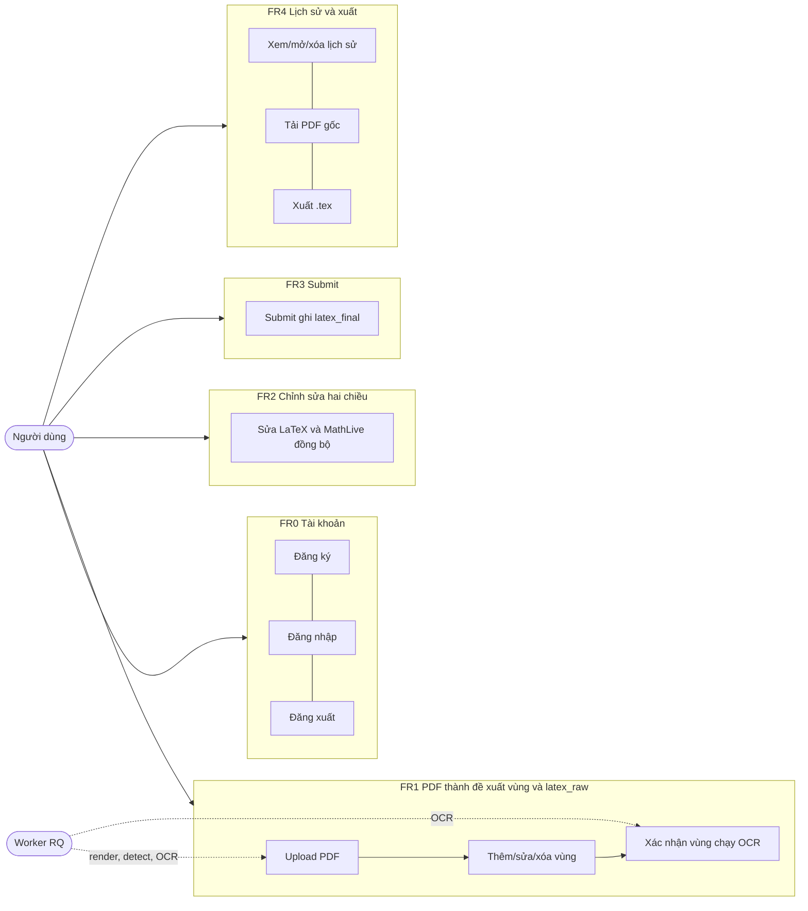
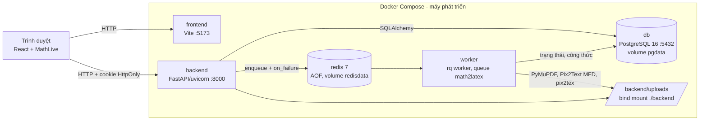
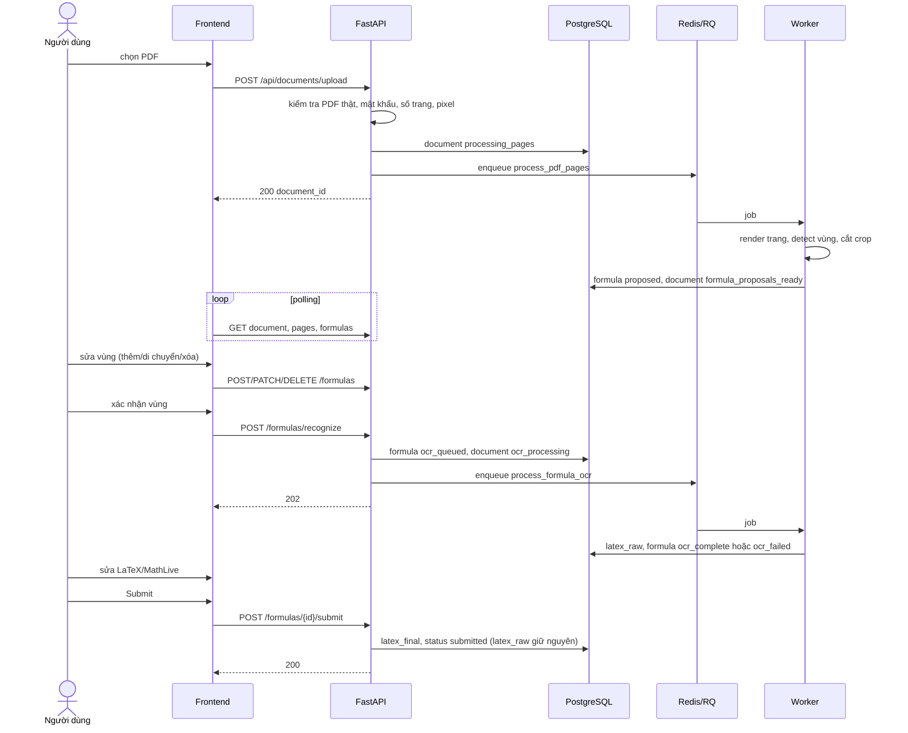
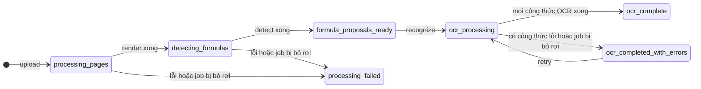
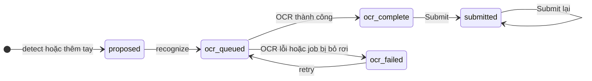
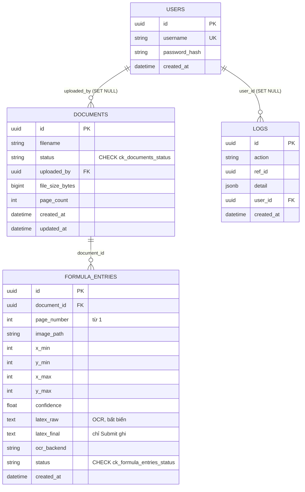

# Sơ đồ hệ thống

Sơ đồ vẽ bằng Mermaid (GitHub và VS Code hiển thị được). Nội dung lấy từ mã nguồn ngày 2026-11-10; khi đổi model, trạng thái hoặc Compose phải sửa lại cùng PR. Các sơ đồ này **chưa được render thử bằng công cụ Mermaid** trong môi trường phát triển; nếu có lỗi cú pháp, sửa theo thông báo của trình xem.

## 1. Chức năng theo tác nhân

## 2. Kiến trúc và triển khai (Docker Compose)

## 3. Luồng upload → OCR → Submit

## 4. Trạng thái

Document cũ có thể ở trạng thái `uploaded` (trước khi có pipeline nền). Chỉ công thức `proposed` mới sửa/xóa được vùng.

## 5. Mô hình dữ liệu

Tọa độ bbox là pixel của ảnh trang đã render (150 dpi). File PDF, ảnh trang và crop nằm ở `UPLOAD_DIR/<document_id>/` ngoài database.
